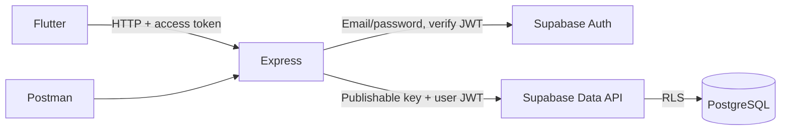
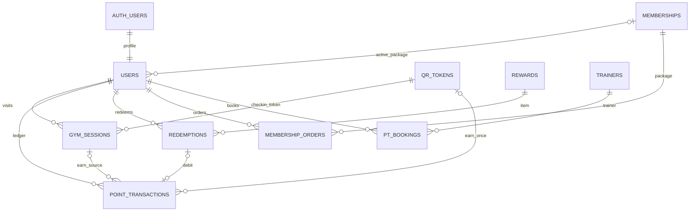

# GymFlow — Backend Foundation với Supabase

QR tự đổi mỗi giờ và giữ mã giữa các lần mở admin, upload avatar/quà/PT, quên mật khẩu bằng mã email đã được bổ sung. Giữ nguyên migration 003 và lịch QR. Sau 003, áp dụng migration 004 theo [WORKFLOWS.md](../supabase/WORKFLOWS.md): check-in cộng 5 GP tối đa một lần mỗi ngày Việt Nam; kích hoạt Basic/Premium/VIP cộng lần lượt 100/200/300 GP. Home gym chỉ được backfill khi có đúng một gym ID đang có QR còn hiệu lực; nếu không, để trống.

**API nghiệp vụ đã bổ sung:** QR/check-in/check-out, occupancy/biểu đồ, đổi quà, đơn gói tập, lịch PT, lịch sử, sửa hồ sơ và quản trị danh mục. Đọc [WORKFLOWS.md](../supabase/WORKFLOWS.md) để chạy migrations 002/004, deploy API mới và cấp quyền admin. Phần bên dưới mô tả thiết lập database ban đầu; không chạy lại migration 001 trên database đã được tạo.

Để các thành viên chỉ cần Flutter, xem [API chung trên Supabase](../supabase/SHARED_API.md). Bản deploy dùng lại Express routes, được sinh thành một file để dán vào Dashboard. Backend local bên dưới vẫn phục vụ phát triển/test.

Bộ khởi tạo cho task **Khởi tạo Backend + Database** (TV3), kèm Auth và Rewards read API để kiểm tra Integration Gate tuần 1. Node.js/Express chạy REST API riêng; Supabase cung cấp PostgreSQL, Auth và Data API. Không cần cài PostgreSQL trên máy hoặc tạo database mới: dùng project `resjlmqdtxubcbdpvtds` đã có.

Đã đối chiếu [ý tưởng sản phẩm](https://docs.google.com/document/d/1Ho7S-_n1iWUJZlT2aRpj5lt57yQ37q2r1X0SZY9Do-c/edit) và [kế hoạch nhóm, tab 1475494824](https://docs.google.com/spreadsheets/d/1UXj1wANkhXcTXNxpRgGMnm7LyIGH7p6A5tUBSXUdBbs/edit?gid=1475494824#gid=1475494824). Với database mới, làm các bước 1–4 bên dưới; với database đã có bảng, chỉ áp dụng migration bổ sung theo WORKFLOWS.md.



## 1. Tạo 10 bảng trong project Supabase

1. Mở [project Supabase của nhóm](https://supabase.com/dashboard/project/resjlmqdtxubcbdpvtds), đăng nhập bằng tài khoản có quyền project. Nếu project đang paused, resume trước.
2. Chọn **SQL Editor → New query**. Mở file [`../supabase/migrations/001_initial_schema.sql`](../supabase/migrations/001_initial_schema.sql), copy toàn bộ nội dung, nhấn **Run**.
3. Tạo query mới, copy [`../supabase/seed.sql`](../supabase/seed.sql), nhấn **Run**. Có 4 rewards, 3 gói Basic/Premium/VIP và 2 PT demo. `image_url` để trống; nhóm điền URL ảnh của mình trong Table Editor.
4. Mở **Table Editor → schema public** và kiểm tra đủ các bảng bên dưới.

Migration `001` chỉ chạy **một lần**. Nếu lỗi, transaction rollback toàn bộ migration. Nếu báo bảng đã tồn tại, hãy kiểm tra schema hiện tại và đối chiếu trước; không xóa bảng đang có dữ liệu. Đổi schema sau này bằng migration `002...`, không chỉnh `001` rồi chạy lại. Seed có thể chạy lại và không reset stock/point cost đã thay đổi.

| Bảng | Vai trò và cột chính |
| --- | --- |
| `users` | Hồ sơ: `id`, `name`, `role`, `active_membership_id`, `membership_expires_at`. `id` liên kết `auth.users.id`. |
| `gym_sessions` | Phiên tập: `user_id`, `gym_id`, `qr_token_id`, `check_in_at`, `check_out_at`. Phiên mở có checkout null. |
| `qr_tokens` | `gym_id`, `token_hash`, `issued_at`, `expires_at`, `revoked_at`. QR sống tối đa 1 giờ. |
| `point_transactions` | Ledger: `user_id`, `type` EARN/REDEEM, `points` có dấu, `reason`, nguồn session/QR/redemption. |
| `rewards` | `name`, `description`, `points`, `stock`, `image_url`, `is_active`. |
| `redemptions` | `user_id`, `reward_id`, `points_spent`, `status`, `idempotency_key`. |
| `memberships` | Catalogue gói: `price_vnd`, `duration_days`, `points_per_checkin`. |
| `membership_orders` | Đơn gói: `user_id`, `membership_id`, giá/thời hạn chốt khi đặt, `status`, ngày approve/bắt đầu/kết thúc. |
| `trainers` | `name`, `specialty`, `experience_years`, `description`, `image_url`. |
| `pt_bookings` | `user_id`, `trainer_id`, `slot`, `status` CONFIRMED/CANCELLED. |

Quy ước: UUID cho khóa chính; `gym_id` là text, hiện dùng `'1'` để khớp Home của Flutter. `timestamptz` lưu thời điểm; API trả ISO 8601, hiển thị giờ Việt Nam tại client. Giá lưu số nguyên VND. Các bảng catalogue dùng `is_active` để ẩn thay vì xóa bản ghi đã có lịch sử.

Schema bảo vệ: một user chỉ có một phiên mở; mỗi user/QR chỉ có một EARN; stock không âm; point cost dương; một redemption có tối đa một giao dịch REDEEM; trainer và user không được trùng slot CONFIRMED. Slot MVP cố định 60 phút, bắt đầu đúng giờ, không có bảng lịch rảnh riêng trong v1.

Migration 002 bổ sung RPC transaction cho check-in/redeem, kiểm tra điểm/tồn kho, đơn gói và đặt lịch. Client vẫn không được ghi trực tiếp vào các bảng bảo vệ.

## 2. Thiết lập Supabase Auth và RLS

Trong Dashboard, kiểm tra **Authentication → Sign In / Providers → Email** được bật (tên menu có thể khác theo phiên bản Dashboard). Bộ API dùng Supabase Auth, nên password được Supabase hash và lưu trong `auth.users`; không có password plaintext hoặc password column trong `public.users`.

Khi register, trigger tự tạo `public.users` với role `MEMBER`. Không insert user trực tiếp trong Table Editor để thay cho đăng ký Auth. Migration cũng tạo profile cho tài khoản Auth có từ trước. Email lấy từ Supabase Auth; `public.users` không lưu bản sao dễ bị lệch khi đổi email.

Nếu **Confirm email** đang bật: đăng ký → kiểm tra email → xác nhận → đăng nhập. `POST /auth/register` trả `requires_email_confirmation: true`, `access_token: null` khi chưa có session. Flutter hiển thị hộp thoại xác nhận email rồi đưa về login. Nếu Supabase trả session ngay, app vào Home. Supabase có thể trả kết quả che giấu tài khoản đã tồn tại, nên không dùng HTTP 201 làm bằng chứng rằng vừa tạo user mới.

RLS đã bật cả 10 bảng. Catalogue active được đọc công khai; hồ sơ, lịch sử session/point/order/booking chỉ đọc được của chính người đăng nhập. Client không được ghi điểm, stock, membership hoặc đọc `qr_tokens`. Starter sử dụng publishable key + JWT của user, để RLS áp dụng cả khi gọi Data API ngoài Express. Xem [hướng dẫn RLS](https://supabase.com/docs/guides/database/postgres/row-level-security) và [profile liên kết Auth](https://supabase.com/docs/guides/auth/managing-user-data).

## 3. File `.env` và kết nối database

Trong project, mở **Settings → API Keys** lấy **publishable key** (`sb_publishable_...`); legacy **anon key** cũng dùng được. Project URL kiểm tra tại **Connect / API settings**. Không cần database password hoặc `DATABASE_URL` cho starter này vì Express đọc PostgreSQL qua Supabase Data API HTTPS.

Mở PowerShell:

```powershell
cd D:\TEC550030\backend
Copy-Item .env.example .env
```

Mở `.env` và điền:

```dotenv
PORT=3000
HOST=0.0.0.0
SUPABASE_URL=https://resjlmqdtxubcbdpvtds.supabase.co
SUPABASE_PUBLISHABLE_KEY=YOUR_ACTUAL_PUBLISHABLE_OR_ANON_KEY
CORS_ORIGINS=http://localhost:5173,http://localhost:3000
```

`.env` đã bị ignore; commit `.env.example` để các thành viên tự cấu hình. Starter không dùng secret/service_role key. Khi bổ sung API admin/RPC sau này, secret key chỉ nằm ở backend, không đặt trong Flutter, Git, QR hoặc request gửi từ app. Secret/service_role bỏ qua RLS, nên API dùng key đó phải tự xác minh quyền. Xem [API keys của Supabase](https://supabase.com/docs/guides/getting-started/api-keys).

Nếu nhóm muốn dùng `pg`/Prisma thay cho Data API ở sprint sau, vào **Connect** lấy đúng connection string của project. Backend lâu chạy trên máy chỉ có IPv4 dùng **Session pooler**; không đoán region/host và không dùng URL `supabase.co` làm `DATABASE_URL`. Xem [các kiểu kết nối PostgreSQL](https://supabase.com/docs/guides/database/connecting-to-postgres).

## 4. Chạy Express và kiểm tra kết nối thật

Yêu cầu Node.js 22 trở lên; repo đã có `package-lock.json`. Trên PowerShell dùng `npm.cmd` để tránh lỗi execution policy của `npm.ps1`:

```powershell
cd D:\TEC550030\backend
npm.cmd ci
npm.cmd run dev
```

Mở terminal khác:

```powershell
Invoke-RestMethod http://localhost:3000/health
Invoke-RestMethod http://localhost:3000/rewards
```

Health thành công trả `{ "status": "ok", "database": "connected" }` sau khi thực sự query bảng rewards. `/rewards` trả mảng 4 bản ghi seed. Nếu health 503: kiểm tra project hoạt động, URL/key đúng, đã chạy migration, và schema `public` được expose trong Data API. Nếu thiếu env, server dừng ngay và chỉ báo tên trường thiếu.

`npm.cmd test` kiểm tra HTTP/auth contract và thực thi migration/seed trên PostgreSQL nhúng PGlite. Đây là kiểm thử local; để xác nhận kết nối với project thật vẫn phải chạy `/health`, register/login và `/me` sau khi cấu hình `.env`.

## 5. API đã có cho task nền tảng

Base URL local: `http://localhost:3000`. Request/response là JSON; lỗi dạng `{ "code": "...", "message": "..." }`.

| Method | Endpoint | Auth | Chức năng |
| --- | --- | --- | --- |
| GET | `/health` | Không | Kiểm tra truy vấn DB |
| POST | `/auth/register` | Không | `{name,email,password}`; password tối thiểu 8 ký tự |
| POST | `/auth/login` | Không | `{email,password}`; trả user/access token/refresh token |
| POST | `/auth/refresh` | Không | `{refresh_token}`; trả session mới |
| GET | `/me` | Bearer JWT | Hồ sơ của user hiện tại |
| GET | `/rewards`, `/rewards/:id` | Không | List/detail reward active |
| GET | `/memberships`, `/memberships/:id` | Không | List/detail gói active |
| GET | `/trainers`, `/trainers/:id` | Không | List/detail PT active |
| GET | `/points/balance` | Bearer JWT | Tổng ledger của user; ban đầu 0 |
| GET | `/points/history` | Bearer JWT | Giao dịch của user; ban đầu `[]` |

List APIs hỗ trợ `?limit=100&offset=0`, tối đa 100 mỗi trang; response vẫn là mảng để khớp Flutter. `balance` được SUM trong PostgreSQL, không bị giới hạn số dòng trả về của Data API. Auth có giới hạn 30 request/IP mỗi 15 phút. Starter chưa cấu hình reverse proxy; khi deploy hãy thiết lập `trust proxy` theo hạ tầng thật để rate limit dùng đúng IP.

Test Auth bằng PowerShell (thay bằng email của bạn để nhận thư xác nhận):

```powershell
$registerBody = @{ name = 'Nguyen Van A'; email = 'YOUR_EMAIL'; password = 'GymflowDemo2026!' } | ConvertTo-Json
Invoke-RestMethod -Method Post -Uri http://localhost:3000/auth/register -ContentType 'application/json' -Body $registerBody
# Nếu bật Confirm email: xác nhận email trước bước login.
$loginBody = @{ email = 'YOUR_EMAIL'; password = 'GymflowDemo2026!' } | ConvertTo-Json
$session = Invoke-RestMethod -Method Post -Uri http://localhost:3000/auth/login -ContentType 'application/json' -Body $loginBody
$headers = @{ Authorization = "Bearer $($session.access_token)" }
Invoke-RestMethod http://localhost:3000/me -Headers $headers
Invoke-RestMethod http://localhost:3000/points/balance -Headers $headers
Invoke-RestMethod http://localhost:3000/points/history -Headers $headers
```

Trong Postman tạo environment `base_url=http://localhost:3000`, `access_token`; chạy register/login rồi copy access token vào Authorization → Bearer Token. Có mẫu request trong [`requests.http`](requests.http). Access token đăng nhập và QR token là hai loại token riêng.

## 6. Nối Flutter với API

Các service hiện tại đã gọi đúng route auth, `/me`, `/rewards` và `/points`. `ApiClient` đã hỗ trợ cấu hình base URL khi chạy:

```powershell
cd D:\TEC550030\tec550030
# Android Emulator: 10.0.2.2 trỏ tới máy host.
flutter run --dart-define=API_BASE_URL=http://10.0.2.2:3000
# Điện thoại Android thật: thay bằng IPv4 LAN của máy chạy Express.
flutter run --dart-define=API_BASE_URL=http://192.168.1.10:3000
```

Máy tính và điện thoại cần cùng mạng; Express bind `0.0.0.0`; Windows Firewall phải cho phép Node/port 3000 trên mạng đang dùng. Test URL `/health` từ trình duyệt điện thoại trước. Native Flutter không bị CORS; Flutter web phải thêm origin thực tế vào `CORS_ORIGINS`. Nếu Android chặn HTTP cleartext, chỉ bật cho cấu hình debug hoặc dùng HTTPS; bản deploy dùng HTTPS.

Frontend đã lưu access/refresh token và tự gọi `/auth/refresh` khi API riêng tư trả 401; nhiều request đồng thời dùng chung một lần refresh. Khi refresh bị từ chối, app xóa phiên và về login. Lỗi mạng/5xx không xóa phiên. UI lấy profile, balance/history, rewards, memberships và trainers qua REST API; không còn mock fallback. Dùng `/health`, response `/rewards`, và thay tên/stock reward trong Supabase rồi kéo refresh trên app để kiểm chứng dữ liệu thật.

Home hiển thị profile, ví điểm, gói tập, QR và occupancy. Chạm catalogue mở detail với đổi quà/gửi đơn/chọn lịch PT; Tài khoản có lịch sử hoạt động và màn hình quản trị theo role. Lịch sử điểm có nút tải thêm; catalogue tự tải các trang khi vượt 100 bản ghi.

## 7. API nghiệp vụ và triển khai

Danh sách endpoint, quy tắc giao dịch, luồng UI và cách deploy phiên bản mới được mô tả trong [WORKFLOWS.md](../supabase/WORKFLOWS.md). Dùng migration 002 sau migration 001; function chung cần deploy lại sau khi cập nhật backend.

## 8. ERD và checklist bàn giao



- [ ] Chạy migration và seed trên project đúng; Table Editor đủ 10 bảng.
- [ ] `.env` local đúng, không xuất hiện trong `git status`.
- [ ] Express chạy port 3000; `/health` báo `database: connected`.
- [ ] `/rewards` đọc đủ 4 reward từ database.
- [ ] Register tạo cả Auth user và profile; login trả token; `/me` đọc đúng user.
- [ ] Không có token hoặc token giả: `/me` trả 401.
- [ ] Tài khoản A không đọc được lịch sử của B; chưa có giao dịch thì balance 0/history `[]`.
- [ ] Flutter login và rewards dùng API thật; sửa reward trong DB rồi reload thấy thay đổi.
- [ ] Chạy `npm.cmd test`; lưu ảnh response/API làm evidence task.

Chỉ đánh dấu task online hoàn tất sau khi các bước cấu hình và kiểm tra trên project thật đã pass.
